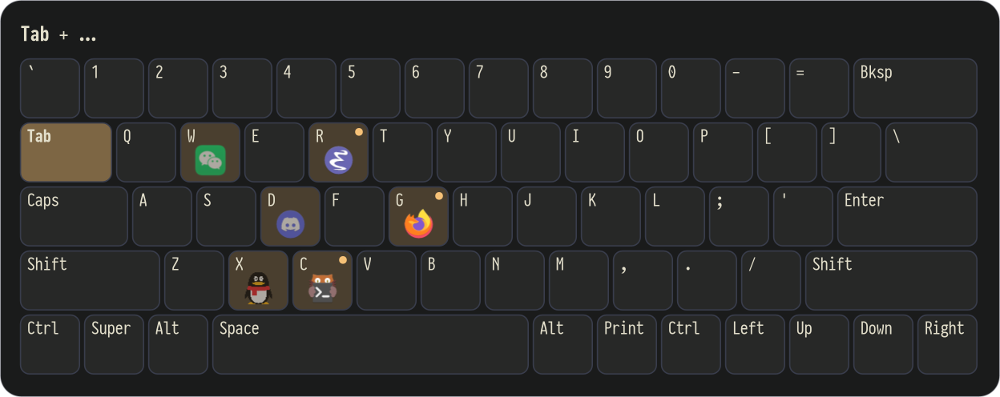
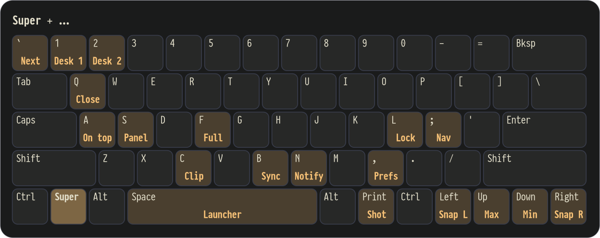
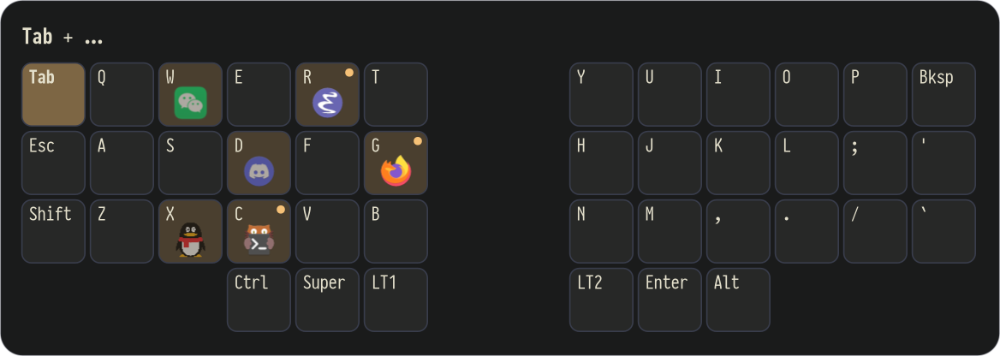

# keydock

Pin applications to letter keys on wlroots compositors (labwc, niri, Hyprland, sway).
The examples bind Super+letter; any trigger that runs `keydock key <letter>` works.

Hold the trigger key for a moment and a keyboard shows what each key does:



- **A pinned letter** focuses the app, hides it when it is already focused, or launches it.
  Its windows on the current workspace come forward together, the most recently used on top;
  with none there, the key goes to the workspace of its latest window. Hiding also acts on that
  workspace only, and switching windows across workspaces is left to the compositor.
  Windows you minimized one by one stay minimized. An app that closed to the tray is restored
  from its tray icon instead of being launched again, when its executable is named like its app id.
- **Hiding** minimizes the app's windows. Tiling compositors (niri, Hyprland, sway) ignore
  minimize requests; keydock notices on the first hide and switches to focusing the previous
  app instead, like Cmd+Tab. `keydock status` shows which behaviour is in use.
- **The overlay** (Super+/ in the examples) shows a keyboard with the pinned apps on their letters
  and the open, unpinned apps on the numbers. Letters and numbers switch to an app; Esc closes it.
- **A number** (`keydock key 1`) switches to that open, unpinned app, most recently used first,
  so the numbers change as you switch apps.
- **An unpinned letter** opens the overlay so you can pin an open app to that letter;
  with no open app to pin, it says so and closes itself.
- **Peeking**: when the trigger key is held for a moment, the same keyboard appears, and it goes
  away when the key is released or a letter is pressed. It takes no key or pointer input, so
  letters keep switching apps while it shows. Other layers can be shown the same way. This needs
  a trigger that reports both press and release, such as a kanata layer key;
  see [Peeking with kanata](#peeking-with-kanata).

keydock tracks its own most-recently-used window order through
`wlr-foreign-toplevel-management`, so the behaviour does not depend on compositor internals.
No protocol says which workspace a window is on, so keydock notes the active workspace from
`ext-workspace` whenever a window gets focus. A window that has not had focus since the daemon
started counts as on every workspace, and so does every window where `ext-workspace` is missing.
The overlay is a layer-shell surface drawn with cairo and pango, with fractional scaling.
Its text follows the session language (`LANGUAGE`, `LC_ALL`, `LC_MESSAGES`, `LANG`) as the daemon
saw it when it started: English, Simplified Chinese and Traditional Chinese are included, with
English as the fallback.

## Commands

```text
keydock key <letter>   focus, hide or launch the app pinned to <letter>
keydock key <1-9>      focus that open, unpinned app
keydock overlay        show or hide the overlay
keydock peek [layer]   a layer's key is held: show it on a keyboard after a moment
keydock peek off       the key is released: hide it
keydock status         list tracked windows, most recently used first, with their workspace
keydock reload         re-read desktop entries and icons
keydock daemon         run the background service (other commands start it if needed)
```

## Configuration

`~/.config/keydock/config.toml`:

```toml
font = "sans"          # optional overlay font
hide = "auto"          # auto | minimize | previous (focus the previous app)
key_label = "Super"    # the trigger's name: titles the keyboard, highlights that key
warp = "super+ctrl+alt+shift+p"  # chord for the compositor's cursor warp; "" disables it

[[app]]
key = "c"
app_id = "kitty"       # as shown by `keydock status`; "emacs" also matches "emacs-32-0-50"
exec = "kitty"         # launch command when no window exists
```

### Layers

A layer of another tool, shown by `keydock peek <name>`. The text follows the session language,
and keys without a translation keep the text from `keys`:

```toml
[[layer]]
name = "windows"
prefix = "Super"       # the keys held, e.g. "Super+;"; highlighted when the keyboard has them

[layer.keys]
q = "Close"
Left = "Snap left"

[layer.translations.zh_CN]   # or "zh" for every Chinese locale
q = "关闭"
```



### Keyboard layouts

The keyboard is `ansi` unless told otherwise; `corne` is also built in. A rule picks a layout
while a device is connected, matching part of its name in `/proc/bus/input/devices`:

```toml
layout = "ansi"        # the default
peek_delay_ms = 400    # how long a key is held before the peek shows

[[keyboard]]
device = "Corne"
layout = "corne"
```

A layout without number keys gets a row of them below it when open, unpinned apps need one.
Layouts in `~/.config/keydock/layouts/<name>.toml` add to these or replace them. Each row lists
its keys; `label:width` sets a width in key units and `_:width` leaves a gap. Layer keys and
prefixes refer to these labels.

```toml
rows = [
  "Tab:1.5 q w e r t _:2 y u i o p",
  "_:3 Super Space",
]
```



Overlay colors are read from `~/.config/keydock/colors.toml` each time the overlay opens.
Without the file a built-in dark palette is used. Any of these keys can be set:

```toml
surface = "#282828"
on_surface = "#fbf1c7"
primary = "#b8bb26"
outline = "#57514e"
```

With [Noctalia](https://github.com/noctalia-dev/noctalia), a user template keeps it in sync
with the shell palette. Put the file above in `~/.config/noctalia/templates/keydock.toml` with
values such as `"{{colors.primary.default.hex}}"`, and register it in Noctalia's config:

```toml
[theme.templates.user.keydock]
input_path = "$XDG_CONFIG_HOME/noctalia/templates/keydock.toml"
output_path = "$XDG_CONFIG_HOME/keydock/colors.toml"
```

## Compositor support

Requires `wlr-foreign-toplevel-management` and `wlr-layer-shell`; `virtual-keyboard` is used for
the cursor warp, and `fractional-scale` with `viewporter` for crisp text. Tested on labwc.
niri, Hyprland and sway implement these protocols but are untested; GNOME and KDE do not.

## Compositor setup (labwc)

Bind every free Super+letter to `keydock key <letter>` (on release), Super+/ to
`keydock overlay`, and add the cursor-warp callback keydock sends after focusing an app.
Any modifier works: the letter after `key` only names the app, so Hyper or Alt bindings are
fine, and so is a key remapper such as kanata running the command directly. Set `key_label`
to match, and keep the `warp` chord free of app bindings.

```xml
<keybind key="W-c" onRelease="yes"><action name="Execute" command="keydock key c" /></keybind>
<keybind key="W-slash"><action name="Execute" command="keydock overlay" /></keybind>
<keybind key="W-C-A-S-p"><action name="WarpCursor" to="window" x="center" y="center" /></keybind>
```

Start `keydock daemon` from the session autostart. Any other command starts it if needed.

## Peeking with kanata

A peek that never hears its release closes itself after 30 seconds, and `keydock peek` does nothing
when the daemon is not running.

A held Tab can be the trigger: its layer sends `keydock key <letter>`, and pressing and
releasing it send `keydock peek` and `keydock peek off`. Set `key_label = "Tab"` so the
keyboard highlights Tab. Run the commands as the desktop user when kanata runs as root.

```lisp
(defalias
  tab-apps (tap-hold-press 200 200 tab
             (multi (layer-while-held apps)
                    (cmd keydock peek)
                    (on-release tap-vkey peek-off))))

(defvirtualkeys
  peek-off (cmd keydock peek off))

(deflayermap (apps)
  a (cmd keydock key a)
  ;; ... one line per letter, and 1 to 9 for the open, unpinned apps
  1 (cmd keydock key 1)
  / (cmd keydock overlay))
```

Any key can show a layer of its own with `keydock peek <name>`, including a modifier, which can
stay a modifier: `(multi lmet (cmd keydock peek windows) (on-release tap-vkey peek-off))`.

A layer whose keys do not go through keydock can hide the keyboard on the first key, so it
does not cover what you are doing:

```lisp
(deftemplate nn (key)
  (multi $key (cmd keydock peek off)))

(deflayermap (numnav)
  h (t! nn left))
```

The `cmd` action needs `danger-enable-cmd yes` in `defcfg` and a kanata build with it enabled.

## Other compositors (untested)

Bind the same commands; the cursor-warp chord is only needed where the compositor does not
move the pointer to the focused window by itself.

```text
# sway
bindsym --release Mod4+c exec keydock key c
bindsym Mod4+slash exec keydock overlay

# Hyprland
bindr = SUPER, C, exec, keydock key c
bind = SUPER, slash, exec, keydock overlay

# niri (binds section)
Mod+C { spawn "keydock" "key" "c"; }
Mod+Slash { spawn "keydock" "overlay"; }
```

## Build

```sh
cargo build --release && install -Dm755 target/release/keydock ~/.local/bin/keydock
```

Needs Rust 1.88 or newer, and cairo, pango and libxkbcommon.

## Development

```sh
cargo fmt --check && cargo clippy --all-targets -- -D warnings && cargo test
```

CI runs the same checks. The code is split so the decisions can be tested without a compositor:

| File | Role |
|---|---|
| `src/tracker.rs` | Window list in most-recently-used order and the show/hide decisions, returned as actions. No Wayland types; most tests live here. |
| `src/windows.rs` | Feeds foreign-toplevel events into the tracker and sends its actions to the compositor. |
| `src/tray.rs` | Restores an app from its StatusNotifierItem tray icon over D-Bus before launching it. |
| `src/config.rs` | Loading, validating and appending to `config.toml`. |
| `src/overlay.rs` | The layer-shell overlay, drawn with cairo and pango. |
| `src/keyboard.rs` | Draws a keyboard showing what each key does in a layer. |
| `src/layout.rs` | Keyboard layouts, built in or from the user's files. |
| `src/desktop.rs` | Desktop entries and icon-theme lookup. |
| `src/i18n.rs` | Session language and overlay text. |
| `src/main.rs` | Command line, the daemon's socket and event loop, and wiring. |

## License

MIT, see [LICENSE](LICENSE).
